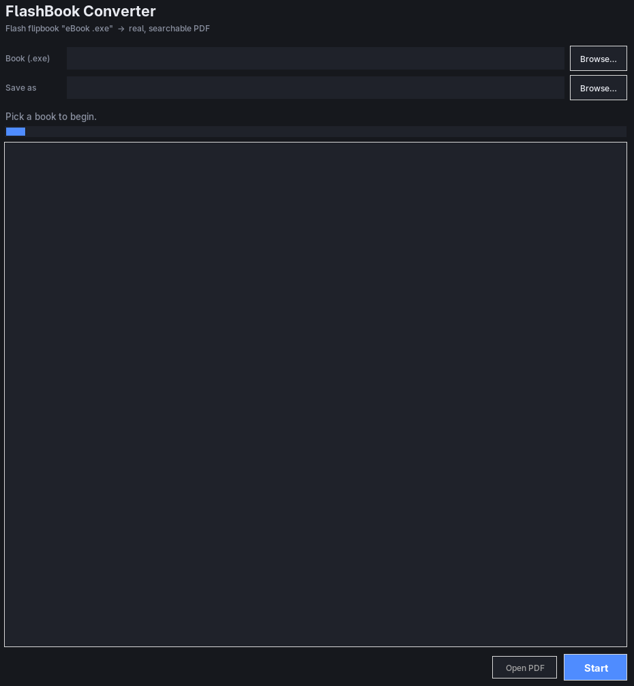

# 📖 flashbook-exe2pdf

[](https://github.com/AbdoSol1iman/flashbook-exe2pdf/actions/workflows/desktop-build.yml)

Convert old **"eBook .exe"** files (Flash flipbooks made with *Flip PDF Professional* and
similar tools) into **real PDFs** — vector text you can select and search, embedded fonts,
all graphics, and a bookmark per page.

Dead Flash, live book.

```
"$ ./"Natural Language Processing .exe"   ← 24 MB launcher
  │
  ├── [PE image]        Flash player + reader UI        (ignored)
  └── [overlay]         manifest + 212 embedded SWFs     ← your book lives here
                              │
                              ▼
"Natural Language Processing.pdf   ← 207 pages, 12.5 MB, searchable ✔
```

## 🖱 Desktop app (no Python needed)

A minimal cross-platform GUI is included — pick the .exe, click **Start**, get the PDF.



**Download a ready-made binary** (Windows / Linux / macOS, no installation):
from the repo **[Releases page](https://github.com/AbdoSol1iman/flashbook-exe2pdf/releases)** —
`FlashBook-Converter-windows.exe`, `FlashBook-Converter-linux`, `FlashBook-Converter-macos`.
Each build is produced automatically by GitHub Actions on every release tag.

**Run from source instead:**

```bash
pip install pypdf
python3 flashbook_gui.py
```

The GUI still needs **Java** on the machine (the bundled binary checks for it;
Windows users can grab a JRE from [adoptium.net](https://adoptium.net)). The
renderer (JPEXS ffdec) is downloaded automatically on first conversion.

## Quick start (command line)

```bash
# requirements: python3, java (JRE), and pypdf
pip install pypdf

python3 flashbook_exe2pdf.py "Natural Language Processing .exe"
# → /same/folder/Natural Language Processing.pdf
```

On first run it downloads **[JPEXS ffdec](https://github.com/jindrapetrik/jpexs-decompiler)**
once (~22 MB, cached in `~/.cache/flashbook-exe2pdf/`).

```bash
# options
python3 flashbook_exe2pdf.py "Book.exe" -o MyBook.pdf        # choose output
python3 flashbook_exe2pdf.py "Book.exe" --extract-only       # just unpack + dump index
python3 flashbook_exe2pdf.py "Book.exe" --workdir ./work     # keep scratch files
python3 flashbook_exe2pdf.py "Book.exe" --ffdec /path/ffdec.jar   # offline
```

## What it does (6 steps)

1. **Locates the overlay** — parses the PE section table; everything after the last
   section is the launcher's attached filesystem.
2. **Reads the manifest** — `name=index` lines, sorted *lexicographically*
   (`1, 10, 100, …`) — this quirk is the heart of the ordering puzzle.
3. **Carves every embedded SWF** — compressed Flash files are self-delimiting
   (zlib streams), so exact stored sizes are recoverable; no phantom files.
4. **Finds ground truth** — the reader embeds its own full-text search index
   (`bookText.xml`): the *text of every page, in reader order*.
5. **Re-matches order** — model: page `P` = blob `lexrank(P) + 3`.
   Verified against the search index word-overlap (fails → falls back to
   text-similarity greedy matching). Every page SWF is then rendered with
   ffdec `frame:pdf` → **vector** output with embedded CID fonts.
6. **Merges + bookmarks** — one PDF, one bookmark per page (titled with the
   page's own text), metadata from the launcher config.

Typical run: **< 2 minutes** for a 200-page book (the demo book: ~80 s).

## Does my .exe qualify?

Run `strings "Book.exe" | head -40` and look for:

| You see | Meaning |
|---|---|
| `book.swf`, `files/large/`, `bookText.xml` | ✔ this tool was built for these (Flip PDF family) |
| `FWS`/`CWS` signatures or "Flash Player" | ✔ Flash flipbook, high confidence |
| `EBooksWriter`, `ACTIV E-Book` | ✋ different compiler family — tool may still work via fallback, check output carefully |

Not supported (yet): standard installers/SFX (use `7z`), DRM-protected readers.

## Limitations

- Assumes the packer keeps blob **#1 = reader shell**, #2 = assets, rest = pages
  (true for the tested Flip PDF Professional 2.4.9 output).
- With no embedded search index the ordering falls back to storage order — always
  eyeball the first pages of the output.
- No DRM cracking is performed, by design.

## How it was built

This tool is the distilled version of a hands-on reverse-engineering session —
see **[the full step-by-step writeup](docs/writeup.md)** with actual code
snippets, the ordering forensics, and every bug hit along the way.

## Repository layout

```
flashbook-exe2pdf/
├── flashbook_exe2pdf.py   ← conversion engine + CLI (single file, stdlib + pypdf)
├── flashbook_gui.py       ← minimal Tkinter desktop front-end
├── .github/workflows/     ← builds the desktop binaries (Win/Linux/macOS)
├── README.md              ← quick start, how it works, "does my .exe qualify?" table
├── docs/writeup.md        ← the full forensics writeup with code snippets
├── LICENSE / .gitignore
```

## License

MIT — use freely; no warranty. Use only on books you have the right to convert.
